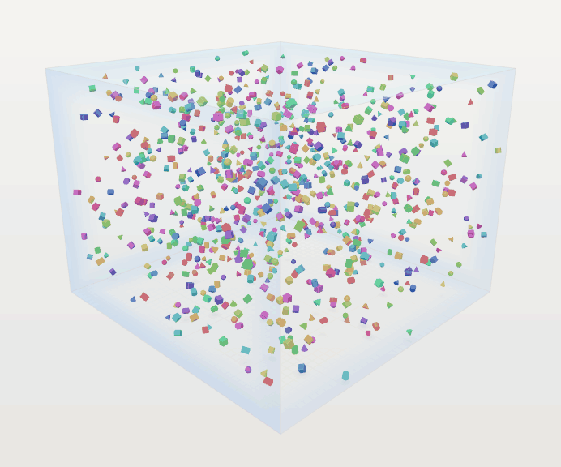
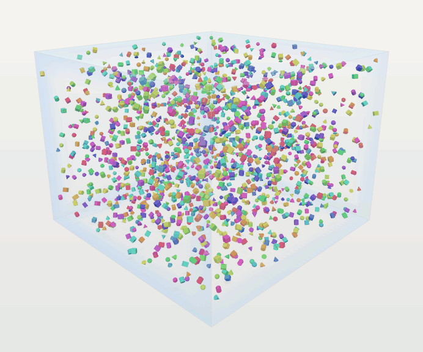
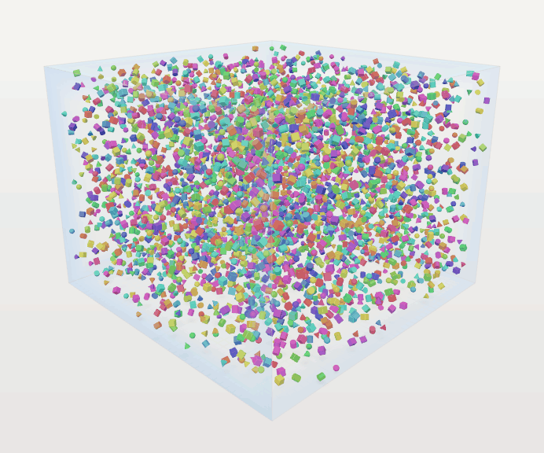
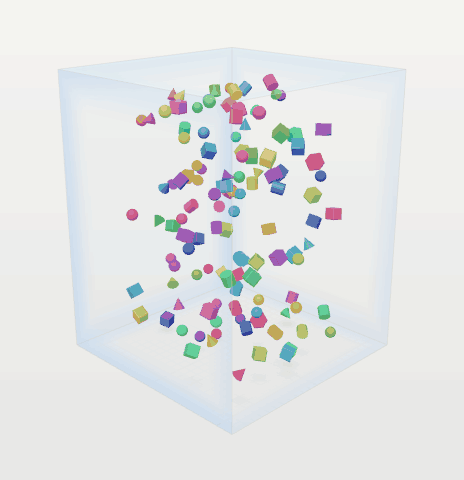
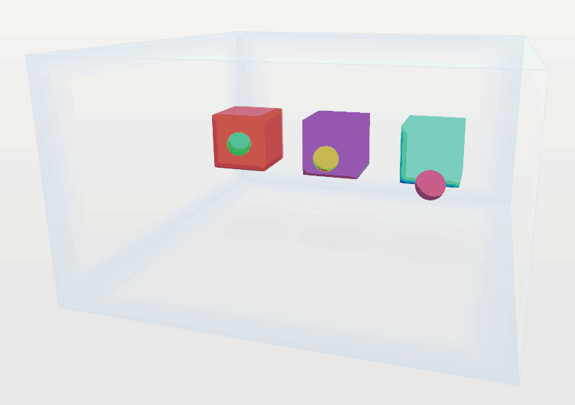

<table width="100%">
  <tr>
    <td align="left" valign="middle" width="45%">
      <h1>Chasing the Moment of<br>Impact</h1>
    </td>
    <td align="right" valign="middle" width="55%">
      <a href="https://isocpp.org/"></a>
      <a href="https://developer.nvidia.com/cuda-toolkit"></a>
      <a href="https://www.opengl.org/"></a>
      <a href="https://cmake.org/"></a>
      <a href="https://ninja-build.org/"></a>
      <a href="https://www.python.org/"></a>
      <a href="https://www.glfw.org/"></a>
      <a href="https://github.com/g-truc/glm"></a>
      <a href="https://github.com/Dav1dde/glad"></a>
      <a href="https://github.com/ocornut/imgui"></a>
      <a href="https://github.com/nlohmann/json"></a>
      <a href="https://www.microsoft.com/windows"></a>
      <a href="https://www.kernel.org/"></a>
    </td>
  </tr>
  <tr>
    <td colspan="2" align="left">
      <p><b>Physics of Rigid Bodies from Collision Prediction to Efficient Resolution through Iterative Constraints</b></p>
      <p><em>A 3D rigid-body engine that runs the same collision scenes on a CPU reference and on CUDA. Each tick is hashed, so you can check that both backends agree exactly, from the first contact to the last. The OpenGL viewer shows where objects hit and how hard.</em></p>
      <p>
      
      
      
      </p>
      </td>
  </tr>
  <tr>
    <td colspan="2" align="center">
      <a id="simulation-gallery"></a>
      <p>
      <a href="media/matrices/cpu-A.gif"></a>
      <a href="media/matrices/cpu-B.gif"></a>
      <a href="media/matrices/cpu-C.gif"></a>
      <a href="media/cpu-demo.gif"></a>
      <a href="media/cpu-impact.gif"></a>
      </p>
      <p>
      <a href="media/matrices/cuda-A.gif"></a>
      <a href="media/matrices/cuda-B.gif"></a>
      <a href="media/matrices/cuda-C.gif"></a>
      <a href="media/cuda-demo.gif"></a>
      <a href="media/cuda-impact.gif"></a>
      </p>
    </td>
  </tr>
</table>

<p align="center">
  <a href="#quick-start"></a>
  <a href="#highlights"></a>
  <a href="#results"></a>
  <a href="#under-the-hood"></a>
  <a href="#configuration"></a>
  <a href="#viewer"></a>
  <a href="#outputs"></a>
  <a href="#repository-layout"></a>
  <a href="#license"></a>
</p>

---

<br>
<a id="quick-start" href="#quick-start"></a>
<br><br>


From the repository root, build the CPU and CUDA backends with the OpenGL viewer and launch Matrix A. The examples use SM 89. Set the architecture flag to your GPU’s compute capability.

**Windows · PowerShell**

```powershell
.\scripts\deployment\build-windows.ps1 -Cuda -Viewer -Architecture 89
.\exports\builds\windows-x64\physics_viewer.exe --backend cuda --scenario A
```

**Linux · Bash**

```bash
bash ./scripts/deployment/build-linux.sh --cuda --viewer --arch 89
./exports/builds/linux-$(uname -m)/physics_viewer --backend cuda --scenario A
```

For CPU-only use, omit `-Cuda` or `--cuda` and launch with `--backend cpu`. The CPU build supports the same box scenes and viewer controls. See [build requirements](#configuration) for toolchain and driver details.

<br>
<a id="highlights" href="#highlights"></a>
<br><br>


- **Reproducible.** CPU and CUDA matched all 720 per-tick state hashes in each recorded A/B/C verification run.
- **Parallel.** The CUDA solver groups contacts that affect different bodies so it can resolve them concurrently.
- **Preallocated.** The step loop reuses bounded working buffers after setup.
- **Inspectable.** Local heatmaps show where impacts occur and how much energy they carry.
- **Tested.** The suite includes a 1,000,000-tick stack stability check.
- **Measurable.** The command-line runner exports per-stage timings, contact counts, and state hashes.

<br>
<a id="results" href="#results"></a>
<br>

### Correctness

The November 7, 2026 verification advanced each matrix for 720 ticks on both backends. A matching tick means the independently computed state hashes were equal. An escaped tick is a tick where the containment diagnostics found a body outside the enclosure.

| Scenario | Bodies | Matching ticks | Escaped ticks (CPU / CUDA) | Final state hash (both) |
| --- | ---: | ---: | ---: | --- |
| [Matrix A](configs/scenarios_matrix_a.yaml) | 850 | 720/720 | 0 / 0 | `3330260331900169050` |
| [Matrix B](configs/scenarios_matrix_b.yaml) | 1,750 | 720/720 | 0 / 0 | `3349342891293941449` |
| [Matrix C](configs/scenarios_matrix_c.yaml) | 4,000 | 720/720 | 0 / 0 | `11731164910491628103` |

| Verification setting | Recorded value |
| --- | --- |
| Initial conditions | Seed 42 · 720 ticks · fixed step of 1/120 s · float32 state |
| Hardware | Intel Core i9-14900HX · NVIDIA GeForce RTX 4070 Laptop GPU |
| Toolchain | Windows x64 · MSVC 19.51 · CUDA Toolkit 13.4.92 · SM 89 |

These results describe the recorded runs. The longer stack stability check is a separate test in the suite.

### Performance

| Scenario | CPU median / p95 (ms/tick) | CUDA median / p95 (ms/tick) | Contact samples (CPU / CUDA) |
| --- | --- | --- | --- |
| Matrix A | pending | pending | pending |
| Matrix B | pending | pending | pending |
| Matrix C | pending | pending | pending |

Use the same tick window on both backends and report the median and 95th percentile of `total_wall_ms` from `frames.csv`. The median describes a typical tick; p95 shows how long the slower ticks take. Sum `contacts_i` over the window for contact samples. A persistent contact can contribute once per tick, so that sum does not count unique collisions. Record the hardware, toolchain, and source fingerprint alongside measured timings.

See the [simulation gallery](#simulation-gallery) for side-by-side recordings of all three matrices.

### Reproduce the parity check

Record Matrix A on the CPU and replay its initial state and configuration on CUDA. Replay compares the state hash on each recorded tick. Use `B` or `C` in place of `A` to check the larger matrices.

```powershell
$physics = '.\exports\builds\windows-x64\physics.exe'
& $physics --backend cpu --scenario A --seed 42 --ticks 720 --output generated/reports/matrix-a-cpu
& $physics --backend cuda --replay generated/reports/matrix-a-cpu
```

```bash
physics="./exports/builds/linux-$(uname -m)/physics"
"$physics" --backend cpu --scenario A --seed 42 --ticks 720 --output generated/reports/matrix-a-cpu
"$physics" --backend cuda --replay generated/reports/matrix-a-cpu
```

The CTest suite checks position and velocity agreement across five seeds and verifies repeatable CUDA hashes on A/B/C. The replay command checks exact per-tick hashes for the specific recorded run.

<br>
<a id="under-the-hood" href="#under-the-hood"></a>
<br>

### State and candidate pairs

The engine stores each body property in its own contiguous array. This **structure of arrays** lets a pass work with the properties it needs, such as positions and bounds. Impact telemetry allocates its buffers on first use and then reuses them.

| Responsibility | CPU reference | CUDA backend |
| --- | --- | --- |
| State | Advances host arrays on a single thread. | Advances device buffers and downloads state when requested. |
| Candidate ordering | Sorts grid entries by cell key and body ID. | Uses a stable radix sort that preserves body ID order within each cell. |
| Contact solving | Applies impulses in sequence. | Resolves contacts in parallel within each color group, then synchronizes before the next group. |

The **broad phase** searches nearby cells of a spatial grid and filters candidate pairs by their bounds. The **narrow phase** tests those pairs against the actual shapes and supplies contact points, normals, and penetration depths to the solver. Supported shapes are spheres, cubes, cylinders, and cones.

### Contact resolution

Each contact constrains motion along its normal and applies friction along the surface. The sequential impulse solver revisits those constraints for a fixed number of passes. An impulse changes the velocities read by later passes, so contacts that share a dynamic body must be processed in order.

**Graph coloring** assigns contacts that share no dynamic body to the same group. CUDA resolves the contacts within each group in parallel and synchronizes before moving to the next group. The current solve runs in one CUDA block, so scaling depends on the number and size of the color groups. After velocity solving, a separate position correction reduces remaining overlap. The wall path includes continuous collision detection for fast spheres, and the position pass checks box containment.

### Ten stages per fixed tick

| # | Operation | Work performed |
| ---: | --- | --- |
| 1 | Apply forces | Reset force accumulators and apply gravity. |
| 2 | Integrate velocity | Update linear and angular velocities using the fixed time step. |
| 3 | Refresh bounds | Recompute world-space axis-aligned bounding boxes (AABBs). |
| 4 | Broad phase | Gather candidate pairs from the sorted spatial grid. |
| 5 | Body contacts | Test candidate shapes and build body-to-body contacts. |
| 6 | World contacts | Build contacts against the six enclosure faces. |
| 7 | Solve contacts | Apply normal and friction impulses, then correct residual overlap. |
| 8 | Integrate pose | Advance positions and orientations and enforce wall containment. |
| 9 | Update sleep | Let supported, quiet bodies rest and wake them when contacts disturb them. |
| 10 | Emit diagnostics | Collect timing, energy, momentum, contact, and containment counters. |

### Numerical reproducibility

Both backends use the same fixed-step configuration and shared collision math. CPU compilation uses strict floating-point settings, and CUDA disables fused multiply-add contraction with `--fmad=false`. When comparing hashes, use the same initial state, scenario, precision, and tick count. Record the compiler and device alongside the results so a later run has the context needed to reproduce the comparison.

<br>
<a id="configuration" href="#configuration"></a>
<br>

### Build requirements

| Build profile | Requirements |
| --- | --- |
| Base CPU build | CMake 3.27+, Ninja, Git, and a C++20 compiler. The Windows script uses MSVC and the Windows SDK. |
| CUDA | Base tools, CUDA Toolkit 12.4+, a supported host compiler, and a CUDA-capable GPU. |
| OpenGL viewer | Base tools, an OpenGL 4.6 driver, and Python 3 for GLAD generation. On Linux, install the development headers for the window system used by GLFW. |

CMake fetches pinned dependencies into the build directory during configuration. The first configure needs network access.

| Windows option | Linux option | Purpose |
| --- | --- | --- |
| `-Cuda` | `--cuda` | Build CUDA alongside the CPU backend. |
| `-Viewer` | `--viewer` | Build the interactive OpenGL viewer. |
| `-Architecture 89` | `--arch 89` | Select the CUDA target architecture. |
| `-ReferenceDouble` | `--reference-double` | Build the CPU-only float64 reference. |

### Scene settings

The headless runner accepts `--backend cpu` or `--backend cuda`, `--scenario A`, `B`, `C`, or `demo`, and `--config FILE` for a flat YAML configuration. The three matrix files in [configs/](configs/) are starting points for custom scenes.

| YAML fields | What they control |
| --- | --- |
| `seed`, `spheres_i`, `cubes_i`, `cylinders_i`, `cones_i` | Initial random seed and body counts by shape. |
| `radius_m`, `boxHalfExtentX_m`, `boxHalfExtentY_m`, `boxHalfExtentZ_m` | Initial body size and enclosure half extents in metres. |
| `dt_s`, `gravity_mps2`, `maxInitialSpeed_mps` | Fixed step, gravity, and the cap on initial speed. |
| `restitution_unitless`, `frictionStatic_unitless`, `frictionDynamic_unitless` | Bounce and friction response. |
| `cellSize_m`, `solverIterations_i`, `enableSleep`, `enableCcd` | Broad-phase cell size, solver passes, sleeping, and continuous collision detection. |

Use `--seed N` after the scenario or config argument to override its seed. Use `--ticks N` for run length and `--output DIR` to give each run its own log directory.

### Run the tests

```powershell
ctest --test-dir tmp/build/windows --output-on-failure
ctest --test-dir tmp/build/windows --output-on-failure -R '^cuda_parity_and_determinism$'
```

```bash
ctest --test-dir tmp/build/linux --output-on-failure
ctest --test-dir tmp/build/linux --output-on-failure -R '^cuda_parity_and_determinism$'
```

The CUDA parity test is registered by CUDA-enabled builds.

<br>
<a id="viewer" href="#viewer"></a>
<br><br>

Launch with `--scenario demo` or `--scenario impact` to explore the two [collision demonstrations](#simulation-gallery).

### Controls

| Action | Control |
| --- | --- |
| Start, pause, or reset | **Run**, **Pause**, or **Reset** in the toolbar. |
| Advance exactly one tick | Pause, open **Physics settings** from **Widgets**, then select **Step once**. |
| Reframe the box | Adjust **Orbit**, **Elevation**, and **Zoom** in **Camera & impact display**. |
| Inspect collision bounds | Toggle **AABB**, **OBB**, or **Velocity**. An OBB is a bounding box that rotates with the object. |
| Inspect impact severity | Toggle **Impact heat coloring**, then adjust the fade time or red-energy threshold. |
| Switch backends | Select **CPU** or **CUDA** in **Simulation**. |
| Hide the overlay | Press **F1**. Use **Widgets** to show individual panels. |

For a repeatable still, use `--hidden --presentation --frames N --capture FILE.png`. The viewer saves the final frame and a JSON sidecar with its simulation state hash and capture settings.

<br>
<a id="outputs" href="#outputs"></a>
<br><br>

The headless runner creates these files under the directory passed to `--output`.

| File | Use |
| --- | --- |
| `frames.csv` | Per-tick stage timings, backend time, contact counts, candidate pairs, and physical diagnostics. |
| `trace.csv` | Tick number and state hash, used to locate the first divergence during replay. |
| `manifest.json` | Backend, hardware, compiler, seed, precision, source fingerprint, and final state hash. |
| `config.json`, `initial.json` | Configuration and exact starting state read by replay. |
| `final.json`, `motion.csv` | Final body state and motion data for inspection. |

<details>
<summary><strong>Recorded Matrix A output · selected fields</strong></summary>

CPU run, seed 42. The CSV excerpt shows the first four ticks, with elapsed simulation time rounded to six decimal places. The manifest excerpt describes the complete 720-tick run.

```csv
tick_i,t_s,contacts_i,candidatePairs_i
1,0.008333,24,9
2,0.016667,16,6
3,0.025000,32,6
4,0.033333,41,6
```

```json
{
  "bodyCount_i": 850,
  "seed": 42,
  "ticks_i": 720,
  "realBytes_i": 4,
  "replayHash": "3330260331900169050"
}
```

</details>

Windows builds place the executables and app-local DLLs under `exports/builds/windows-x64/`. In a checkout that includes prebuilt binaries, run `git lfs pull` to fetch them. Keep the DLLs beside the executables and keep the repository’s shaders and fonts available to the viewer. [Git LFS rules](.gitattributes)

<br>
<a id="repository-layout" href="#repository-layout"></a>
<br><br>

| Area | Path | Responsibility |
| --- | --- | --- |
| Simulation data | [src/shared/](src/shared/) | Body storage, geometric primitives, and common simulation math. |
| Physics | [src/physics/](src/physics/) | CPU and CUDA backends, scene generation, replay, and logging. |
| Graphics | [src/client/](src/client/) | OpenGL renderer and Dear ImGui controls. |
| Entry points | [src/demos/](src/demos/) | Command-line runner and viewer. |
| Defaults | [src/settings/](src/settings/) | Compute, collision, and rendering constants. |
| Build | [infra/](infra/) · [scripts/deployment/](scripts/deployment/) | CMake targets and dependencies, plus Windows and Linux build scripts. |
| Scenes | [configs/](configs/) | YAML definitions for Matrix A, B, and C. |
| Tests | [tests/unit/](tests/unit/) | Collision, parity, impact, viewer, and stability checks. |
| Media | [media/](media/) | Simulation recordings and PNG stills. |

<br>
<a id="acknowledgements" href="#acknowledgements"></a>
<br><br>

The engine uses nlohmann/json for run records, GLFW for windowing, GLAD for OpenGL loading, GLM for renderer math, and Dear ImGui for the viewer controls. [nlohmann/json](https://github.com/nlohmann/json) · [GLFW](https://www.glfw.org/) · [GLAD](https://github.com/Dav1dde/glad) · [GLM](https://github.com/g-truc/glm) · [Dear ImGui](https://github.com/ocornut/imgui)

<br>
<a id="license" href="#license"></a>
<br><br>

The project is released under the MIT License. Vulnerability reporting follows the repository security policy. [LICENSE](LICENSE) · [SECURITY.md](SECURITY.md)
